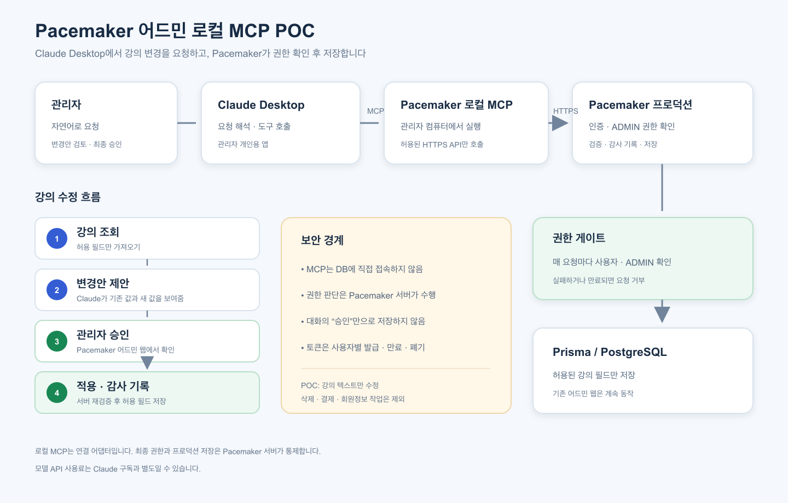
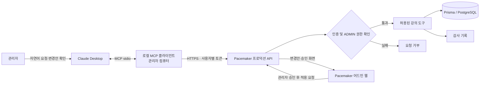
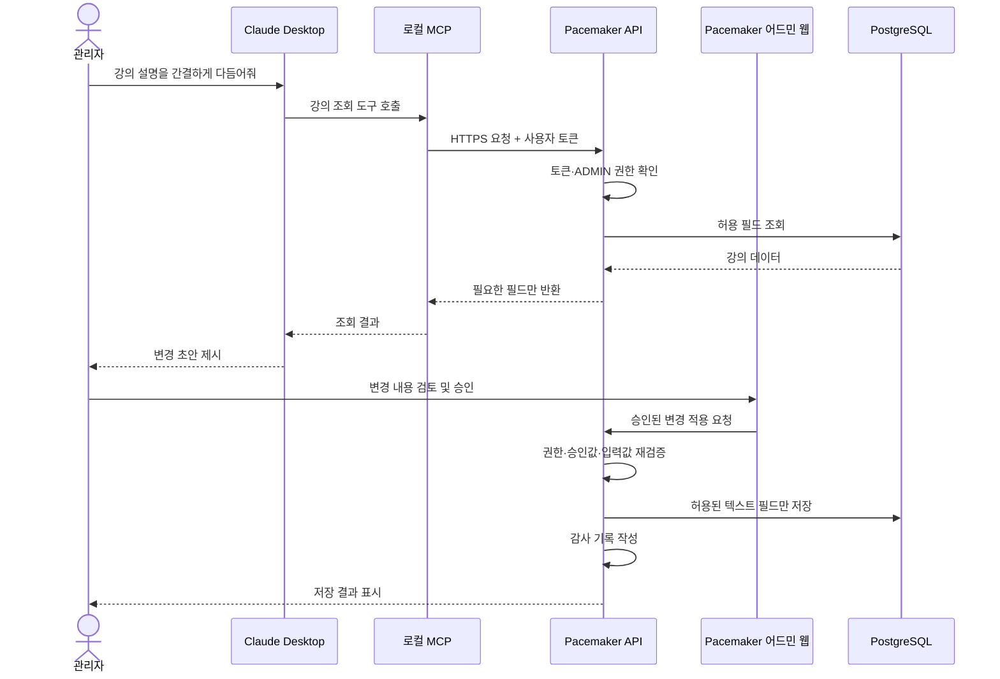

# Pacemaker 어드민 로컬 MCP POC 기획

- 상태: 제안
- 작성일: 2026-10-20
- 범위: Claude Desktop의 로컬 MCP를 이용한 Pacemaker 강의 콘텐츠 변경

## 1. 목적

관리자가 Claude Desktop에 자연어로 요청하고, Claude가 관리자의 컴퓨터에서 실행되는 Pacemaker 로컬 MCP 도구를 통해 프로덕션의 강의 콘텐츠를 조회·수정할 수 있는지 검증한다.

POC는 AI가 임의로 DB에 접근하는 방식이 아니다. 로컬 MCP는 Pacemaker가 제공하는 제한된 HTTPS API를 호출하고, Pacemaker 프로덕션 서버가 사용자 인증, 관리자 권한, 입력값, 변경 승인을 확인한 뒤 저장한다.

## 2. 사용자 시나리오

1. 관리자가 Claude Desktop에서 Pacemaker MCP 도구를 활성화하고 Pacemaker 계정으로 인증한다.
2. 관리자가 “강의 A의 설명을 간결하게 다듬어줘”라고 요청한다.
3. MCP 도구가 해당 강의의 허용된 콘텐츠 필드를 조회한다.
4. Claude가 새 설명 초안을 제안한다.
5. 관리자가 변경안을 확인하고 명시적으로 승인한다.
6. MCP가 승인된 변경만 프로덕션 API에 전달한다.
7. 프로덕션 서버가 권한·승인·입력값을 다시 검증하고 변경 결과와 감사 기록을 반환한다.

## 3. 구성

### 한눈에 보는 구조





### 강의 수정 요청 흐름



> 로컬 MCP는 Claude와 Pacemaker API 사이의 연결 어댑터입니다. DB 접근과 최종 권한 판단은 Pacemaker 서버가 담당합니다.

```text
Claude Desktop
  │ MCP stdio (로컬 프로세스)
  ▼
Pacemaker 로컬 MCP 클라이언트
  │ HTTPS + 사용자별 인증 토큰
  ▼
Pacemaker 프로덕션 AI 전용 API
  │ Clerk 사용자 연결, ADMIN 검사, 검증, 감사 기록
  ▼
기존 서비스 계층 / Prisma / PostgreSQL
```

로컬 MCP 프로세스는 Claude Desktop이 실행하는 도구 어댑터다. 프로덕션에 직접 DB 연결을 만들지 않는다. 사용자가 컴퓨터를 끄면 로컬 도구는 실행되지 않지만, 프로덕션 API는 계속 운영된다.

### 현재 프로젝트 기반

- `src/lib/admin-auth.ts`의 `requireAdminUser()`는 Clerk 사용자 ID를 Pacemaker 사용자 레코드와 연결하고 `roleId === 'ADMIN'`인지 확인한다.
- 강좌 API 일부는 관리자 전용 요청을 이미 검사한다. 하지만 로컬 MCP 요청은 기존 브라우저의 Clerk 세션을 자동으로 갖지 않으므로, 새 연결용 인증 흐름과 엔드포인트가 필요하다.
- 현재 강좌 데이터는 Prisma/PostgreSQL로 접근한다. MCP는 DB에 직접 접속하지 않고, 서버에서 권한을 검사하는 API/서비스를 거쳐야 한다.

## 4. POC 범위

### 포함

- 강의 목록 검색 및 공개 상태 확인
- 강의 단건 조회(POC에서 허용한 필드만)
- 설명 등 제한된 텍스트 필드의 변경안 생성 및 미리보기
- 관리자 승인 후 해당 필드 저장
- 요청자, 작업 종류, 대상 강의, 변경 전후 값, 승인 시각을 포함한 감사 기록
- 사용자 연결 해제 및 토큰 폐기

### 제외

- 강의 삭제, 대량 수정, 즉시 게시/비공개 전환
- 가격, 결제, 환불, 주문, 사용자 권한 관리
- 회원 이메일·주문 내역 등 개인정보 조회
- 임의 SQL, 범용 DB 도구, 임의 URL 호출
- 레주메 업로드·RAG와 일반 사용자 접근

## 5. 필수 구현 요구사항

### 5.1 인증과 계정 연결

- MCP 사용자를 Pacemaker의 Clerk 사용자와 안전하게 연결한다.
- Claude Desktop에서 시작하는 사용자 인증·동의 흐름을 마련한다. OAuth Authorization Code + PKCE 등 지원 가능한 방식을 기술 검증한다.
- 토큰은 사용자별·용도별로 발급하고 최소 권한, 짧은 만료, 안전한 갱신, 즉시 폐기를 지원한다.
- 로컬 설정 파일이나 MCP 실행 인자에 장기 비밀키, 공용 관리자 키, 브라우저 세션 쿠키를 저장하지 않는다.
- 프로덕션 API는 각 요청에서 사용자 식별과 `ADMIN` 역할을 서버 측에서 확인한다.

### 5.2 전용 API와 도구 계약

- 기존 관리자 API를 무검토로 노출하지 않고 MCP 전용 또는 명시적으로 승인된 API 계약을 둔다.
- 최소 도구 집합: `search_courses`, `get_course`, `propose_course_update`, `apply_course_update`.
- 도구 입력은 Zod 등 서버 측 스키마로 검증한다. 식별자, 허용 필드, 문자열 길이, 요청 크기와 호출량을 제한한다.
- 모델에게 임의 데이터베이스 쿼리나 임의 엔드포인트 호출 능력을 주지 않는다.
- 수정 API는 변경 필드와 이전 버전/해시를 확인해 오래된 초안이 최신 데이터를 덮어쓰지 못하게 한다.
- 도구 응답에는 필요한 필드만 포함하고, 오류 응답에서 토큰·내부 경로·DB 정보를 누출하지 않는다.

### 5.3 변경 승인

- 변경안과 실제 저장 도구를 분리한다. `propose`는 저장하지 않고, `apply`만 변경한다.
- 저장 전에 대상 강의, 필드, 기존 값, 새 값을 관리자가 확인할 수 있어야 한다.
- POC에서 강의 변경은 Pacemaker 어드민 웹에서 최종 확인하는 방식을 우선 검토한다. Claude 대화에서 “승인”이라고 말한 것만으로 프로덕션 변경을 신뢰하지 않는다.
- 서버가 승인 요청을 사용자·리소스·정확한 변경 내용에 묶인 일회성 짧은 만료 승인값으로 보호한다.
- 게시, 삭제 등 고영향 기능은 POC 도구에 포함하지 않는다.

### 5.4 감사·운영

- 변경 성공/실패, 사용자, 대상 리소스, 승인 정보, 요청 ID와 시각을 기록한다.
- 로그에는 전체 프롬프트, 인증 토큰, 불필요한 사용자 데이터나 민감한 강의 초안 전체를 남기지 않는다.
- MCP/API 요청에 시간 제한, 호출량 제한, 입력 크기 제한을 둔다.
- 변경 API에 멱등성 키 또는 중복 요청 방지 처리를 둔다.
- 비밀값을 개발·미리보기·프로덕션 환경별로 분리하고, 노출 시 교체 절차를 문서화한다.

## 6. 보안 요구사항과 위협 대응

| 위험                                  | 필수 대응                                                                                                 |
| ------------------------------------- | --------------------------------------------------------------------------------------------------------- |
| 프롬프트 인젝션으로 허가 밖 작업 유도 | 프롬프트를 보안 경계로 취급하지 않는다. 서버 도구 allowlist, 서버 측 권한 검사와 입력 검증으로 차단한다.  |
| AI가 관리자 권한을 가진 것처럼 행동   | 권한 판단은 Pacemaker 서버만 수행한다. 모델이 제공한 사용자 ID나 role은 신뢰하지 않는다.                  |
| 토큰 유출 또는 다른 관리자와 공유     | 사용자별 짧은 토큰, OS 보안 저장소 사용, 토큰 폐기, 로그·설정·Git에서 비밀값 제외를 적용한다.             |
| 무단/잘못된 콘텐츠 변경               | 제안과 적용을 분리하고, 변경 내용을 보여 준 뒤 별도 승인 단계를 통과해야 저장한다.                        |
| 재전송·중복 호출                      | 만료·일회용 승인값, 요청 ID, 멱등성 처리를 사용한다.                                                      |
| 강의 데이터의 과다 노출               | 응답 필드 최소화, 페이지 크기 제한, 비공개/민감 필드 별도 통제, 호출량 제한을 적용한다.                   |
| 악성 콘텐츠가 모델 지시를 바꿈        | 강의 본문과 검색 결과는 신뢰할 수 없는 데이터로 취급하고 도구 권한·서버 정책을 바꾸는 근거로 삼지 않는다. |
| MCP 로컬 패키지 공급망 문제           | 서명/체크섬이 있는 배포, 의존성 잠금, 최소 권한 실행, 업데이트 출처 검증을 적용한다.                      |
| 프로덕션 API 오남용/비용 급증         | MCP API rate limit, 최대 토큰/요청 제한, 모니터링과 차단 스위치를 둔다.                                   |

## 7. 비기능 요구사항

- MCP가 중단되어도 기존 Pacemaker 웹 어드민과 일반 사용자 기능은 동작해야 한다.
- 사용자별 인증과 운영 로그로 작업을 추적할 수 있어야 한다.
- API 호출 실패·만료·권한 거부를 MCP에서 관리자가 이해할 수 있는 오류로 보여 준다.
- 대화 기록에 프로덕션 데이터가 저장될 수 있음을 사용자에게 안내하고, POC에서는 민감정보를 다루지 않는다.
- 로컬 MCP가 관리자의 컴퓨터에서 실행되므로 지원 대상 OS와 설치·업데이트 경로를 정한다.

## 8. POC 성공 기준

- Claude Desktop에서 로컬 MCP를 설치·실행하고 Pacemaker 계정으로 연결할 수 있다.
- 관리자는 강의 목록과 허용 필드를 조회할 수 있다.
- 일반 사용자, 로그아웃 사용자, 만료/폐기 토큰은 조회와 변경이 거부된다.
- 허용되지 않은 필드, 임의 ID, 잘못된 입력은 서버에서 거부된다.
- 수정안이 승인 전에는 저장되지 않고, 승인 후 정확한 필드만 반영된다.
- 모든 변경 시도를 호출자와 함께 추적할 수 있다.
- 기존 강의 관리자 API와 화면에 회귀 문제가 없다.

## 9. 단계별 진행

1. **기술 검증:** Claude Desktop 로컬 MCP 도구 하나와 테스트용 읽기 API를 연결한다.
2. **읽기 전용:** 프로덕션 권한 검증을 포함해 강의 목록/상세 조회를 구현한다.
3. **변경안 제안:** 강의 설명 초안과 미리보기만 구현하고 저장은 막는다.
4. **승인 저장:** 어드민 웹 승인 UI, 승인 토큰, 제한된 저장 API, 감사 기록을 추가한다.
5. **운영 검토:** 설치 배포, 토큰 회수, 모니터링, 장애 대응을 점검하고 대상 관리자를 확대한다.

## 10. 전제와 미결정 사항

- Claude Desktop은 로컬 MCP를 지원하며, Anthropic 안내상 로컬 데스크톱 확장은 무료 플랜 사용자도 사용할 수 있다. 원격 커넥터는 Pro·Max·Team·Enterprise 대상이다. [로컬·원격 커넥터 안내](https://support.anthropic.com/en/articles/11725091-when-to-use-desktop-and-web-connectors)
- 로컬 MCP 사용은 Pacemaker 프로덕션 접근 권한을 자동으로 제공하지 않는다. 별도 로그인·계정 연결·권한 검증 개발이 필요하다.
- Clerk를 MCP OAuth 인증에 연결하는 구체적인 흐름은 기술 검증이 필요하다. 기존 웹 세션 쿠키 재사용을 전제로 삼지 않는다.
- 최종 승인 UI를 Claude Desktop 내부에서 처리할지 Pacemaker 웹 어드민에서 처리할지 결정해야 한다. 보안상 POC는 웹 어드민 확인을 권장한다.
- 강의의 어떤 텍스트 필드를 수정 대상으로 허용할지, 수정 후 즉시 공개할지 초안 저장만 할지 결정해야 한다.
- 모델 API를 사용할 경우 Claude Desktop의 구독/사용량과 별개로 Pacemaker가 직접 모델 API 요금을 부담하는 구조가 될 수 있다. POC에서 Claude의 MCP 도구 호출을 사용하는 경로와 Pacemaker가 모델 API를 직접 호출하는 경로를 혼동하지 않는다.

## 11. 관련 자료

- [Claude Desktop 로컬 MCP 설치](https://support.anthropic.com/en/articles/10949351-getting-started-with-local-mcp-servers-on-claude-desktop)
- [Claude 로컬·원격 커넥터 비교](https://support.anthropic.com/en/articles/11725091-when-to-use-desktop-and-web-connectors)
- [Claude 원격 MCP 서버 구축 안내](https://support.anthropic.com/en/articles/11503834-building-custom-integrations-via-remote-mcp-servers)
